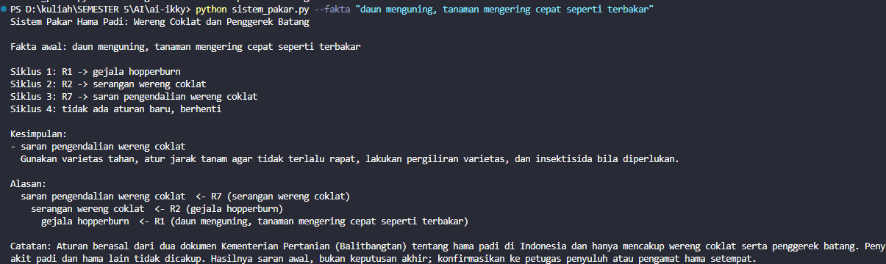
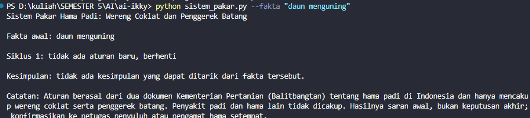
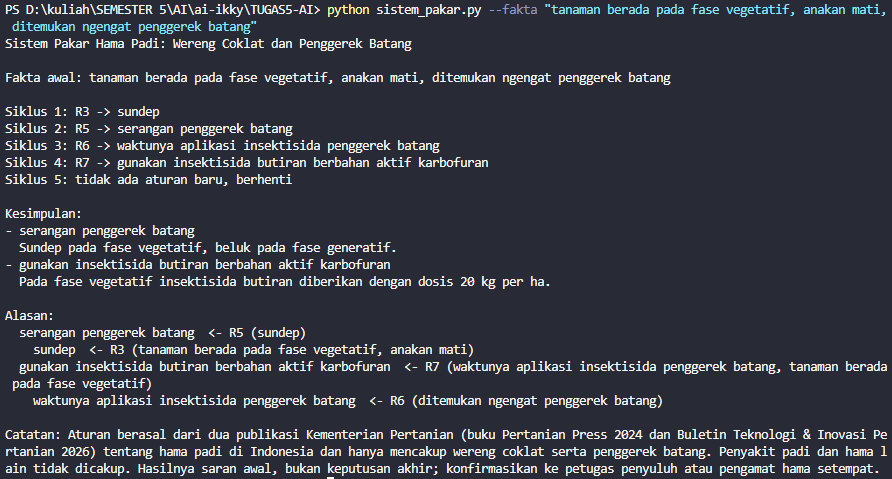

# Tugas 5 — Sistem Pakar Hama Padi

**Nama:** MUHAMMAD RIZKY HISYAM
**NIM:** F1D02410018
**Mata kuliah:** AI

## 1. Topik dan cara menjalankan

Topik: diagnosis hama padi (wereng coklat dan penggerek batang) berdasarkan gejala di lapangan.

- Bahasa: Python 3.8 atau lebih baru, tanpa library tambahan.
- File: `sistem_pakar.py` (mesin) dan `kb_padi.json` (aturan).

Mode tanya jawab:

```
python sistem_pakar.py
```

Mode cepat (fakta "ya" langsung diberikan, dipakai untuk kasus uji):

```
python sistem_pakar.py --fakta "daun menguning, tanaman mengering cepat seperti terbakar"
```

## 2. Sumber dan aturan

Sumber:

- S1: Suprihanto, dkk. 2024. *Pengendalian Hama dan Penyakit Utama Tanaman Padi*. Bogor: Pertanian Press (Balai Besar Pengujian Standar Instrumen Padi). ISBN 978-979-582-277-6. https://epublikasi.pertanian.go.id/pertanianpress/catalog/view/90/91/1784. Diakses 14 November 2026.
- S2: Rachman, R. O. 2026. 6 Ancaman Utama pada Tanaman Padi beserta Cara Pengendaliannya. *Buletin Teknologi & Inovasi Pertanian* 5(1). Balai Besar Perpustakaan dan Literasi Pertanian, Kementerian Pertanian. https://epublikasi.pertanian.go.id/berkala/btip/article/download/4503/4382/11141. Diakses 14 November 2026.

Aturan:

| Aturan | IF | THEN | Sumber |
| ------ | -- | ---- | ------ |
| R1 | daun menguning **AND** tanaman mengering cepat seperti terbakar | gejala hopperburn | S1, S2 |
| R2 | gejala hopperburn | serangan wereng coklat | S1, S2 |
| R3 | fase vegetatif **AND** anakan mati | sundep | S1, S2 |
| R4 | fase generatif **AND** malai putih dan hampa | beluk | S1, S2 |
| R5 | sundep **OR** beluk | serangan penggerek batang | S1, S2 |
| R6 | ditemukan ngengat penggerek batang | waktunya aplikasi insektisida penggerek batang | S1 |
| R7 | waktunya aplikasi insektisida **AND** fase vegetatif | gunakan insektisida butiran berbahan aktif karbofuran | S1 |
| R8 | waktunya aplikasi insektisida **AND** fase generatif | gunakan insektisida semprot cair | S1 |
| R9 | serangan wereng coklat | saran pengendalian wereng coklat | S1, S2 |

Rantai aturan: R1 → R2 → R9, R3/R4 → R5, dan R6 → R7/R8.

### Daftar fakta

Fakta awal ditanyakan ke pengguna sesuai urutan di bawah. Pada mode `--fakta`, penulisannya harus sama persis dengan tabel ini, dipisah koma.

| No | Fakta | Dipakai di |
| -- | ----- | ---------- |
| 1 | daun menguning | R1 |
| 2 | tanaman mengering cepat seperti terbakar | R1 |
| 3 | tanaman berada pada fase vegetatif | R3, R7 |
| 4 | anakan mati | R3 |
| 5 | tanaman berada pada fase generatif | R4, R8 |
| 6 | malai putih dan hampa | R4 |
| 7 | ditemukan ngengat penggerek batang | R6 |

Fakta turunan (hasil aturan, tidak ditanyakan): gejala hopperburn; serangan wereng coklat; sundep; beluk; serangan penggerek batang; waktunya aplikasi insektisida penggerek batang; gunakan insektisida butiran berbahan aktif karbofuran; gunakan insektisida semprot cair; saran pengendalian wereng coklat.

## 3. Metode: Forward Chaining

Forward chaining dipilih karena data yang dimiliki pengguna berupa gejala yang terlihat di sawah, lalu program menurunkan kesimpulan dari gejala itu. Langkahnya:

1. Memori diisi fakta yang dijawab "ya".
2. Cari aturan yang syaratnya terpenuhi dan hasilnya belum ada di memori.
3. Jalankan aturan pertama yang cocok, tambahkan hasilnya ke memori, catat aturan asalnya.
4. Ulangi sampai tidak ada aturan baru.

Mode `dan` berarti semua syarat harus ada di memori, mode `atau` berarti salah satu cukup.

## 4. Kasus uji

| # | Fakta "ya" | Kesimpulan |
| - | ---------- | ---------- |
| 1 | daun menguning, tanaman mengering cepat seperti terbakar | saran pengendalian wereng coklat |
| 2 | daun menguning saja | tidak ada (kasus negatif) |
| 3 | fase vegetatif, anakan mati, ditemukan ngengat penggerek batang | serangan penggerek batang; gunakan insektisida butiran berbahan aktif karbofuran |







## 5. Batas keberlakuan

Aturan berasal dari dua publikasi Kementerian Pertanian (buku Pertanian Press 2024 dan Buletin Teknologi & Inovasi Pertanian 2026) tentang hama padi di Indonesia dan hanya mencakup wereng coklat serta penggerek batang. Penyakit padi dan hama lain tidak dicakup. Hasilnya saran awal, bukan keputusan akhir; konfirmasikan ke petugas penyuluh atau pengamat hama setempat. Catatan ini juga ditampilkan oleh program.

## 6. Penggunaan alat bantu AI

Claude dipakai untuk membantu menyusun kerangka aturan, dan kode.
